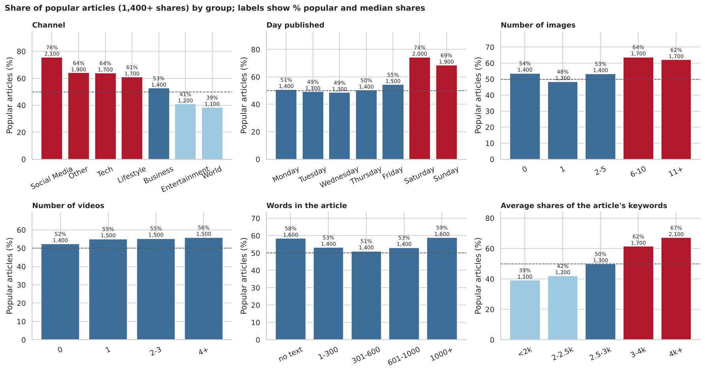
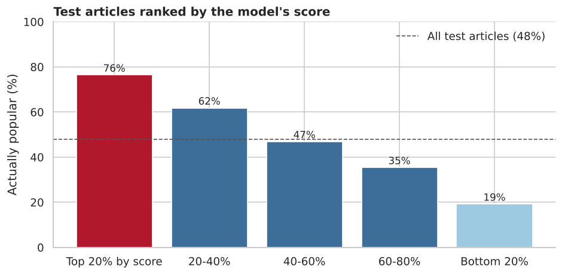

# Social Media Shares Prediction

Predicts whether a news article will be popular on social media (1,400+ shares) using only what is known when it is published. Built on 39,644 real Mashable articles from the UCI Online News Popularity dataset, with models trained on older articles and tested on newer ones.

**Live demo:** https://mq-social-media-shares-prediction.streamlit.app/



## Problem

Publishers decide every day which articles to promote and when to publish them. Knowing in advance which articles are likely to spread on social media helps with both. This project answers:

1. Which article properties are linked to more social media shares?
2. How well can a model rank articles by their chance of being popular, before they are published?

## Dataset

[Online News Popularity](https://archive.ics.uci.edu/dataset/332/online+news+popularity), UCI Machine Learning Repository (K. Fernandes, P. Vinagre, P. Cortez and P. Sernadela, 2015), saved as `data/online_news_popularity.csv.gz`.

39,644 Mashable articles published between 7 January 2013 and 27 December 2014. Each row has 58 features and the number of times the article was shared on social networks.

| Feature group | Examples |
|---|---|
| Channel and timing | lifestyle, entertainment, business, social media, tech, world; day of week, weekend |
| Content | words in title and body, unique word ratios, links, images, videos, keywords |
| Keywords | past shares of articles with the same keywords (worst, average, best) |
| Self-references | shares of other Mashable articles the article links to |
| Topics | five LDA topic weights |
| Language | subjectivity, sentiment polarity, positive and negative word rates, title sentiment |

## Why this dataset

The first version of this project used a 12,000-post "social media engagement" dataset. Checking it showed that `engagement_rate` was exactly (likes + shares + comments) / impressions, so its 96% accuracy came from using those counts as inputs. The counts themselves were independent, uniformly distributed random numbers, and 487 posts had more interactions than impressions. With only information available before posting, including the full post text, no model did better than chance (R2 -0.02, ROC-AUC 0.50). A dataset with no real signal cannot support an engagement model, so this version uses real articles with real share counts.

## Data cleaning

| Issue | Action |
|---|---|
| One article with a unique-word ratio of 701 (must be between 0 and 1) | Removed |
| 23,818 negative values in keyword share columns, used for "no data" | Set to missing |
| 1,181 articles with no body text, mostly video posts | Kept and flagged |
| `url` and `timedelta` (days between publishing and data collection) | Not used as inputs |

No missing values or duplicates otherwise. 39,643 articles remain.

## Key findings

| Group | Popular (1,400+ shares) | Median shares |
|---|---|---|
| Social Media channel | 75.8% | 2,100 |
| Tech channel | 64.1% | 1,700 |
| Entertainment channel | 41.1% | 1,200 |
| World channel | 38.6% | 1,100 |
| Published on Saturday | 74.5% | 2,000 |
| Published on Wednesday | 48.7% | 1,300 |
| Keywords averaging 4,000+ past shares | 67.2% | 2,100 |
| Keywords averaging under 2,000 past shares | 39.3% | 1,100 |

- Weekend articles have a median of 1,900 shares against 1,400 on weekdays (Mann-Whitney U test, p < 0.001).
- Articles with six or more images are popular 62 to 64% of the time, against 48% with one image. Video count and article length make little difference.

## Model

Trained on the oldest 80% of articles (January 2013 to August 2014, 31,714 articles) and tested on the newest 20% (August to December 2014, 7,929 articles).

| Model | ROC-AUC | Accuracy | Precision | Recall |
|---|---|---|---|---|
| Always predict the majority class | 0.500 | 0.479 | 0.479 | 1.000 |
| Logistic Regression | 0.714 | 0.658 | 0.636 | 0.671 |
| Random Forest | 0.733 | 0.670 | 0.642 | 0.707 |
| **Gradient Boosting** | **0.736** | **0.669** | **0.643** | **0.698** |

- Random 5-fold cross-validation gives the same ROC-AUC (0.737), so the model holds up on articles published after the training period.
- Ranked by the model's score, 76% of the top fifth of test articles were popular, against 19% of the bottom fifth.
- Predicting the exact number of shares is much harder: R2 of 0.15 on log(shares).
- The most important features are the keywords' average past shares, the shares of linked Mashable articles and publishing at the weekend.



**Limitations:** one publisher and two years of articles; shares also depend on events outside the article; and the newest articles had less time to collect shares before the data was gathered.

## Web app

- **Score an article:** choose channel, day, length, images, videos, links, keyword strength and subjectivity to get the chance of 1,400+ shares and how the article ranks against recent ones
- **What gets shared:** popularity by channel, day, images, videos, length and keywords
- **Model:** results, ranking table and why the dataset was replaced
- **Data:** source, cleaning steps and a data preview

## Tech stack

Python, Pandas, NumPy, Matplotlib, Seaborn, SciPy, scikit-learn, Streamlit, Jupyter Notebook

## Project structure

```
social-media-shares-prediction/
├── app.py                                    Streamlit app
├── data/
│   └── online_news_popularity.csv.gz         UCI dataset (compressed)
├── notebooks/
│   └── social_media_shares_prediction.ipynb  Cleaning, analysis, modeling and findings
├── reports/
│   ├── figures/                              Charts exported by the notebook
│   ├── model_comparison.csv
│   ├── lift_table.csv
│   └── feature_importance.csv
├── src/
│   ├── data.py                               Loading, cleaning and the time-based split
│   ├── analysis.py                           Summaries, tests and charts
│   └── model.py                              Models, evaluation and importance
├── requirements.txt
└── README.md
```

## Run locally

```bash
git clone https://github.com/Qasim00760/social-media-shares-prediction.git
cd social-media-shares-prediction
pip install -r requirements.txt
streamlit run app.py
```

To run the notebook:

```bash
pip install notebook
jupyter notebook notebooks/social_media_shares_prediction.ipynb
```

## Author

Muhammad Qasim
[Portfolio](https://qasim.devsil.com) | [LinkedIn](https://www.linkedin.com/in/muhammad-qasim-1944b8349) | [GitHub](https://github.com/Qasim00760)
